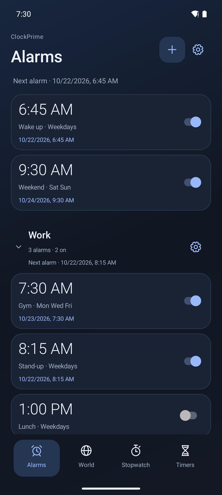
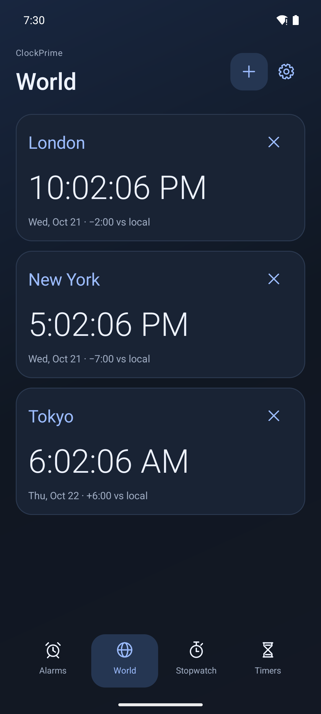
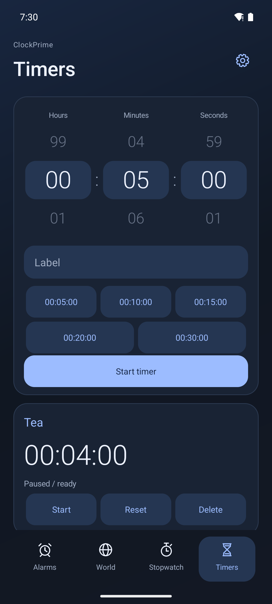
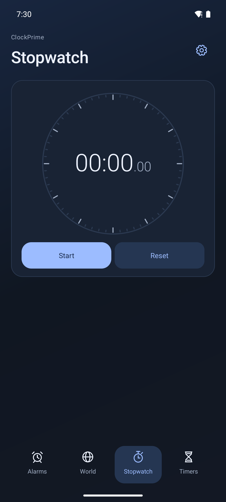
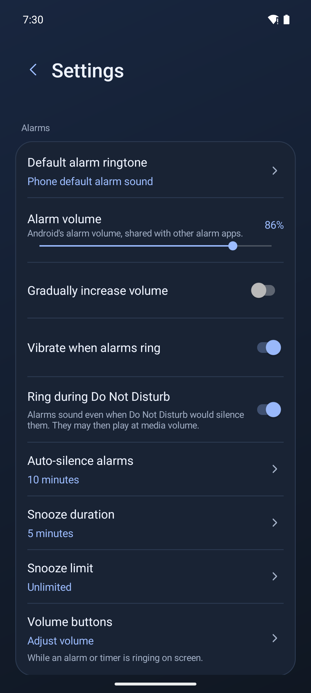

# ClockPrime

A native Android clock app: alarms with named groups, world clocks, a stopwatch, multiple timers and home-screen widgets. Plain Java, no external libraries, no internet permission.

[](LICENSE) [](https://ko-fi.com/mexus)

<p>
  
  
  
  
  
</p>

## Features

- **Alarms:** repeat days, per-alarm ringtone, vibration, snooze duration and limit, and auto-delete for one-time alarms. Gradual volume uses Android's alarm volume. A built-in fallback tone plays if the chosen sound is unavailable.
- **Alarm groups:** groups fold, show their next alarm, and can be turned on or off together. Skip and restore work per occurrence.
- **Reliability:**
  - Alarms use `setAlarmClock` with exact delivery and work before the first unlock after a reboot (Direct Boot).
  - Only one alarm rings at a time: a newer alarm replaces one still ringing.
  - *Ring during Do Not Disturb* option.
  - Audibility warnings for volume, Do Not Disturb, notifications and exact alarms.
- **Ring screen:** full-screen over the lock screen and, with the overlay permission, while unlocked. On Xiaomi HyperOS, alarms, timers and the stopwatch also appear in the Super Island.
- **Timers and stopwatch:** multiple named timers, plus a stopwatch with laps. Both have live notifications.
- **Widgets:**
  - Clocks: Clock & alarm, Clock, Analog, Stacked, Dual clock.
  - Alarms: Next alarm, Alarms, Alarm groups.
  - Others: World clock, Timer (with quick starts), Stopwatch.
- **Settings:**
  - Ringtones, volume, auto-silence and the upcoming-alarm notification.
  - Theme (system / light / dark), date and 12/24-hour formats.
  - Backup export/import and debug log export.
- **Languages:** English and Bulgarian.

## Build

Requirements: JDK 17, Android SDK 35. The Gradle wrapper (8.10.2) is included.

```sh
./gradlew assembleDebug assembleDebugAndroidTest lintDebug
```

On Windows, `tools/build-android.ps1 -Online` runs the same build and copies the APK to `artifacts/ClockPrime-<version>.apk`; add `-Install` to install it with adb.

`python tools/verify-localization.py` checks that every English string has a Bulgarian translation with matching format arguments.

## Device tests

`SmokeTests` is a custom instrumentation runner that exercises the app against the real `AlarmManager` on a device or emulator. It creates temporary `ClockPrime QA` records and restores the previous state afterwards.

```sh
adb install -r app/build/outputs/apk/debug/app-debug.apk
adb install -r app/build/outputs/apk/androidTest/debug/app-debug-androidTest.apk
adb shell pm grant com.clockprime.app android.permission.POST_NOTIFICATIONS
adb shell am instrument -w com.clockprime.app.test/com.clockprime.app.SmokeTests
```

The output ends with `ALL N CHECKS PASSED`, or with `FAIL` and a stack trace. Leave the device alone while it runs: some checks drive the UI.

## CI

GitHub Actions (`.github/workflows/ci.yml`):

- **build:** wrapper validation, localization check, debug and test APKs, and lint. The APKs and the lint report are uploaded as artifacts.
- **device-tests:** runs the full `SmokeTests` suite on an Android emulator for pushes to `main` and manual runs.

## F-Droid

The repository carries what F-Droid needs:
- Store listing: `fastlane/metadata/android/` (English and Bulgarian) with screenshots and the icon.
- Build recipe: `fdroid/com.clockprime.app.yml`, for the fdroiddata repository.
- Unsigned release build: `./gradlew assembleRelease`.

Each release is a `vX.Y.Z` tag with a matching `versionName` and a new `versionCode`, plus a changelog in `fastlane/metadata/android/*/changelogs/<versionCode>.txt`.

## Support

If ClockPrime is useful to you, you can support it on Ko-fi:

[](https://ko-fi.com/mexus)

## License

Copyright (C) 2026 mexus. ClockPrime is free software under the [GNU General Public License v3.0 or later](LICENSE), with two additional terms under section 7 (full wording in [NOTICE](NOTICE)):
- **Attribution:** the "ClockPrime by mexus" credit and the license notice in Settings > About must be kept.
- **Names and logos:** the name "ClockPrime" and its icon are not licensed. Modified versions must use their own name and icon.

Release notes are in [NOTES.md](NOTES.md).
